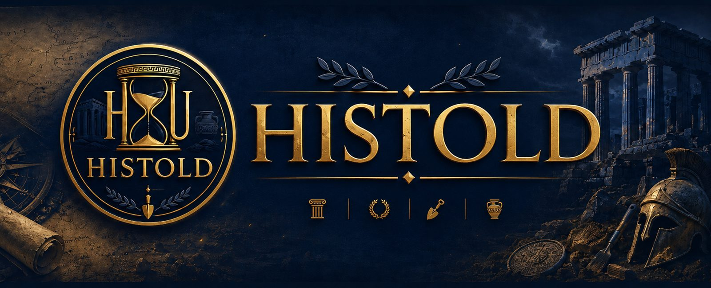
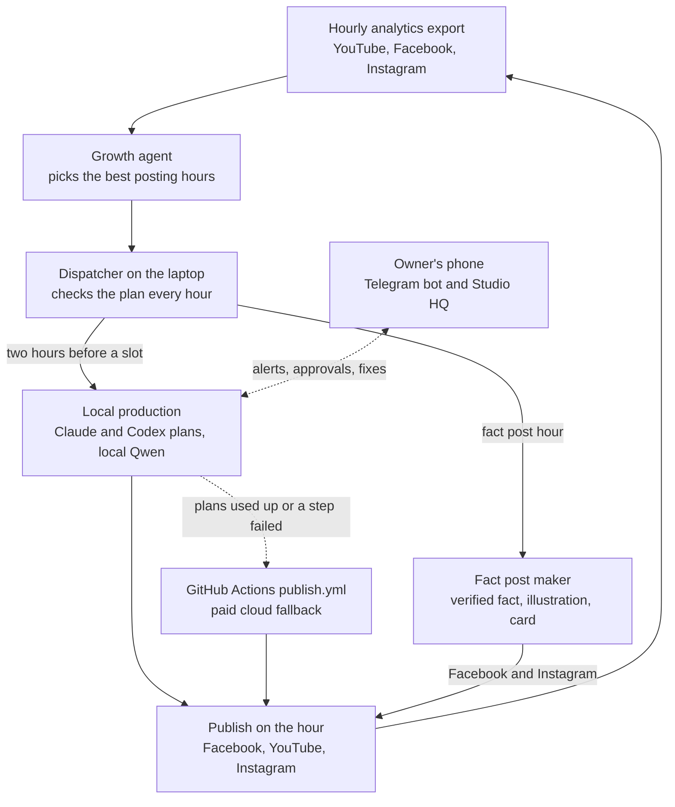
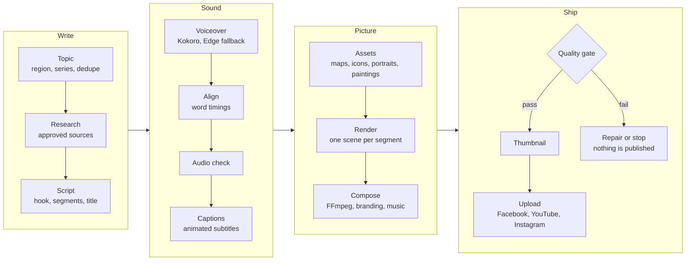

<p align="center">
  
</p>

<h1 align="center">YT Automation</h1>

<p align="center">
  <b>An end to end content studio that researches, writes, narrates, animates, checks and publishes<br>
  history Shorts for the Histold channel, every day, without anyone touching an editor.</b>
</p>

<p align="center">
  <a href="https://www.youtube.com/channel/UCJImBb1E8e0llDt8ISdF_1g"></a>
  <a href="https://github.com/kumarvnsh/YT-Automation/actions/workflows/tests.yml"></a>
  
  
  
</p>

---

Histold tells short, surprising and carefully sourced stories from world history: why Japan once wrapped masterpieces as packing paper, how lifesavers fired a cannon to rescue shipwrecked crews, what a caged canary really did in a coal mine. Every one of those videos was made by this repository.

A single run picks a fresh topic, researches it against approved sources, writes a script for the ear, records a voiceover, draws and animates each scene, lays timed captions on top, runs a strict quality gate and then publishes to Facebook Reels, YouTube Shorts and Instagram Reels. An always on Windows laptop drives the schedule, a growth agent tunes the posting hours from real analytics, and a private Telegram bot plus the Studio HQ dashboard let the owner watch and steer everything from a phone.

## See it in action

These are real Shorts published by the pipeline with no manual editing. Click any thumbnail to watch it on YouTube.

<table>
  <tr>
    <td align="center" width="33%">
      <a href="https://www.youtube.com/shorts/Z6w2dgH6oOk"></a><br>
      <sub><b>Edo Japan's Prized Pale Face Powder Hid a Poison</b></sub>
    </td>
    <td align="center" width="33%">
      <a href="https://www.youtube.com/shorts/v7fM7kWvKF4"></a><br>
      <sub><b>U.S. Lifesavers Fired a Cannon to Rescue Shipwrecked Crews</b></sub>
    </td>
    <td align="center" width="33%">
      <a href="https://www.youtube.com/shorts/S7egTTzf3qc"></a><br>
      <sub><b>Why Were Japan's Masterpieces Once Used as Packing Paper?</b></sub>
    </td>
  </tr>
  <tr>
    <td align="center">
      <a href="https://www.youtube.com/shorts/kItjTLy7eiw"></a><br>
      <sub><b>Were the Pyramids of Giza Really Built by Enslaved People?</b></sub>
    </td>
    <td align="center">
      <a href="https://www.youtube.com/shorts/4U8amYJZRCs"></a><br>
      <sub><b>Coal Miners Sent a Caged Canary Underground Before Going Back In</b></sub>
    </td>
    <td align="center">
      <a href="https://www.youtube.com/shorts/i8oWcZUKfJA"></a><br>
      <sub><b>Sichuan's Ancient Water Scheme Manages a River Without Blocking It</b></sub>
    </td>
  </tr>
</table>

More on the [Histold channel](https://www.youtube.com/channel/UCJImBb1E8e0llDt8ISdF_1g). Every Short also goes out as a Facebook Reel and an Instagram Reel.

## What it does

**It finds stories worth telling.** Topics rotate across nine world regions (India, African countries, Japan, China, Russia, the Middle East, Europe, the Americas, Asia Pacific) and a few recurring series such as *Myths You Learned in School* and *Mistakes That Changed History*. Used and reserved topics are tracked so two videos never cover the same story.

**It researches before it writes.** A research step searches approved institutions and archives, keeps citation excerpts, and hands the script writer an evidence packet instead of letting it improvise. If a story cannot be supported, the run moves on to a different one rather than guessing.

**It writes for the ear.** The script is built around a literally true hook, short spoken sentences and a satisfying answer at the end, split into segments that each become one on screen scene. Titles, descriptions, tags and source credits are written at the same time.

**It sounds human.** Narration uses the open weight Kokoro voice running on CPU, with Edge TTS as a fallback. Word timings come from the voice engine itself, or from a local wav2vec2 forced aligner when those are missing, so captions and reveals land on the exact word.

**It animates every scene.** Each segment becomes an illustrated documentary scene built as HTML and SVG, in one of several art kits (papercut, flat lit, ink folk, cartoon, textured), with vetted map outlines, icons and archival portraits. On the laptop, a painted illustration can be dropped into the most important scenes. Chromium captures each scene frame by frame and FFmpeg assembles the final 1080 x 1920 video with branding, music and animated captions. A Three.js renderer is available as a 3D alternative.

**It refuses to ship bad video.** A deterministic quality gate checks script structure, metadata, narration length, audio, captions, resolution, duration and frame defects such as static openings or frozen scenes. A failed check blocks the upload.

**It publishes everywhere and learns from it.** Uploads go to Facebook Reels first, then YouTube Shorts and Instagram Reels, plus Stories. An hourly analytics export feeds a growth agent that moves at most one posting hour every two weeks toward the hours that actually perform, and a weekly review summarises what is working.

**It also makes fact posts.** A separate track produces 1080 x 1350 image cards for Facebook and Instagram: a verified fact with two sources, a painterly illustration drawn from a licence checked archival reference, and Histold's own text template on top. Cards can wait for the owner's approval in Telegram or Studio HQ before posting.

## How the workflow fits together

### The big picture



The laptop is the conductor. Every hour the dispatcher checks the publishing plan, and when a slot is coming up it starts local production two hours early so the finished video is ready the moment the hour begins. Local runs use the owner's Claude and Codex plans (with local Qwen as a last resort) instead of paid API credits. If the plans are exhausted the run waits for the reset, and if something else breaks before upload the slot is handed to the paid GitHub Actions workflow so the day's post still goes out. An upload is never retried blindly, so there are no double posts.

### Inside one video



Each run writes everything it produces (research packet, script, voiceover, storyboard, captions, scenes, final video and reports) into its own stage folder, so any step can be resumed, inspected or retried without starting over. Every new job also snapshots the configuration it started with, which means changing `config.yaml` never changes a video that is already in progress.

### Steering it from a phone

The Telegram bot is the owner's control desk. It answers only to its paired owner and offers `/today` for the day's uploads and fact posts, `/stats` for views and top videos, `/status` and `/problems` for health checks with one tap fixes, `/posts` for fact cards waiting for approval, and a few maintenance commands for the laptop. Studio HQ is the private web dashboard (React front end, Rust hub, Python data layer) with analytics, live production state, previews, controls and an assistant backed by a local model. It is reached privately over Tailscale and is never exposed publicly.

## Tech stack

| Area | Tools |
| --- | --- |
| Orchestration | Python 3.11, GitHub Actions, Windows Task Scheduler |
| Writing and research | Claude (API or plan), Codex, local Qwen 3 8B through Ollama |
| Voice | Kokoro (`am_michael`) on CPU, Edge TTS fallback, wav2vec2 forced alignment |
| Visuals | HTML and SVG scene kits, Playwright Chromium, Three.js and HyperFrames for 3D, Natural Earth map outlines, game-icons.net, Wikimedia Commons portraits |
| Video | FFmpeg (x264), libass captions |
| Publishing | YouTube Data API v3, Meta Graph API for Facebook and Instagram |
| Analytics | YouTube Analytics, Meta Insights, growth agent, weekly review |
| Control | Telegram bot, Studio HQ (React, Vite, Rust Axum), Tailscale |

## Getting started

### Requirements

You need Python 3.11, Node 22, FFmpeg with libass on your `PATH`, and a Chromium for Playwright. For the Kokoro voice, create a separate Python 3.11 environment with `torch==2.6.0` and `requirements-kokoro.txt`, then point `KOKORO_PYTHON` at its interpreter. Without it the pipeline falls back to Edge TTS.

```bash
git clone https://github.com/kumarvnsh/YT-Automation.git
cd YT-Automation

python -m venv .venv
source .venv/bin/activate          # Windows: .venv\Scripts\activate
pip install -r requirements.txt

npm ci                             # Three.js and HyperFrames for the 3D renderer
python -m playwright install chromium
```

### Keys and sign ins

Copy the example environment file and fill in only the providers you plan to use.

```bash
cp .env.example .env
```

`ANTHROPIC_API_KEY` (or `OPENAI_API_KEY`) writes the scripts, `PEXELS_API_KEY` is only needed for the stock footage fallback, and `META_ACCESS_TOKEN` is a non expiring Meta system user token for Facebook and Instagram. For YouTube, create a Desktop OAuth client in Google Cloud with the YouTube Data API v3 enabled, save it as `secrets/client_secret.json`, and run `python scripts/setup_oauth.py` once to cache the upload token. The `.env` file and the whole `secrets/` folder are git ignored and must never be committed. Uploads also refuse to run unless the signed in channel matches `youtube.expected_channel_id`.

The cloud workflow reads the same values from GitHub Actions secrets; see [GITHUB_ACTIONS_SETUP.md](GITHUB_ACTIONS_SETUP.md). To run production on the laptop with your own Claude and Codex plans, follow [docs/LOCAL_PRODUCTION.md](docs/LOCAL_PRODUCTION.md).

### Your first video

Start small. A dry run writes the research and script only, which is the cheapest way to see what the channel would say.

```bash
# Research and script only
python -m src.main --format short --dry-run

# Make a full Short but keep it on disk
python -m src.main --format short --no-upload

# Make and publish according to config.yaml
python -m src.main --format short
```

Output lands in `output/<timestamp>_short_<slug>/`. Note that `--no-upload` still makes the configured AI calls and may send configured notifications.

### Checks you can run offline

```bash
python -m unittest discover -s tests -t . -v      # unit tests
python scripts/validate_histold_render.py         # Chromium + FFmpeg render check with synthetic audio, no AI calls
python scripts/report_experiment.py               # reads existing exports, no API calls
```

## Configuration

Everything that is not a secret lives in [`config.yaml`](config.yaml), so retuning the channel never needs a code change. The sections you will touch most are these.

| Section | What it controls |
| --- | --- |
| `channel` | Niche, narrator persona and content rules handed to the script writer |
| `editorial` | Regions, series and the rotation used for automatic Shorts |
| `growth` | Posts per day, daily cap, allowed and default posting hours, how often the schedule may change |
| `research` | Approved source domains and how strictly evidence is enforced |
| `script` | Provider and fallback routing (Claude first, OpenAI if it fails) |
| `tts` | Voice engine, voice, speed and the alignment fallback |
| `video` | Resolution, renderer (`cinematic_2d` or 3D), caption style and encode quality |
| `quality` | Thresholds for the pre upload quality gate |
| `youtube`, `meta` | Privacy, category, tags, cross posting, Stories and trial Reels |
| `local_production` | Laptop runs, make ahead hours, parallel render workers, scene style and painted scenes |
| `local_ai` | Provider order and per plan budgets for laptop runs |
| `fact_posts` | Fact post schedule and the approval window |

The 3D renderer can be switched for daily runs with `python -m src.visual_mode on` or `off`, which sets a repository variable rather than editing local config.

## Project layout

```
config.yaml              channel and pipeline settings
src/                     the pipeline: research, script, tts, alignment, scenes, render, quality, uploaders
  pipeline.py            step loop, resumable stage state
  cinematic_*.css/.svg   scene art kits
  plan_ai.py             local Claude, Codex, Antigravity and Qwen routing
  fact_posts.py          fact image cards for Facebook and Instagram
  telegram_control.py    owner bot commands and approvals
scripts/                 entry points: dispatcher, local publisher, analytics, growth agent, reports, setup
studio_hq/               Studio HQ dashboard (Python data layer, React UI, Rust hub)
assets/                  fonts, vetted maps, icons, branding, templates
channels/astrotold/      a separate numerology channel that reuses the same engine
data/                    tracked state: published index, analytics, growth plan, topic reservations
tests/                   unit tests
.github/workflows/       publish, analytics, approve, republish, playlist, tests
docs/                    setup guides and the full operations reference
```

## Further reading

The [operations reference](docs/OPERATIONS.md) is the full manual: the production profile in detail, research recovery rules, alignment, the quality gate, earnings tracking, dashboard setup and automatic recovery. Other guides cover [local production](docs/LOCAL_PRODUCTION.md), [GitHub Actions setup](GITHUB_ACTIONS_SETUP.md), [phone control](docs/PHONE_CONTROL.md), [Studio HQ](docs/creator-control/README.md), the [Facebook content playbook](docs/facebook-content-playbook.md) and [map and source provenance](docs/world-history-sources.md). The Shotsnip clipping channel lives in its own repository, [YT-Cliping-Automation](https://github.com/kumarvnsh/YT-Cliping-Automation).

## Content and credits

Histold aims to be accurate and advertiser friendly. Illustrations are clearly illustrations and are never presented as archival evidence. Map outlines come from Natural Earth, icons from [game-icons.net](https://game-icons.net) under CC BY 3.0, and portraits from Wikimedia Commons with credits written into each video description. Fonts are DM Sans and Libre Baskerville under the SIL Open Font License. Only royalty free music is used.
