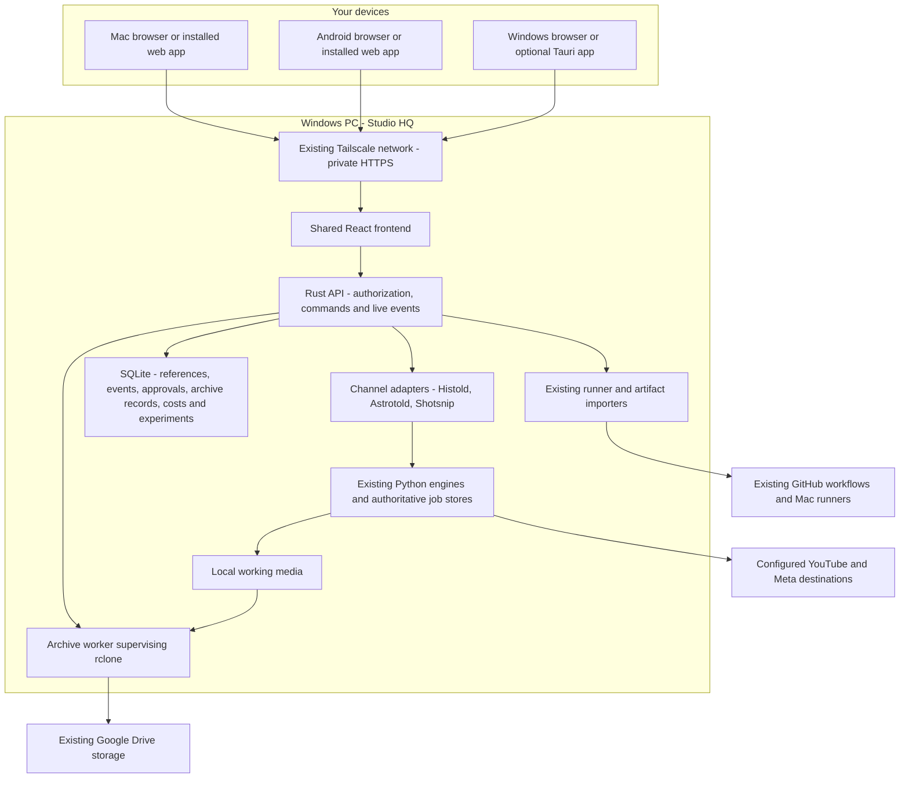
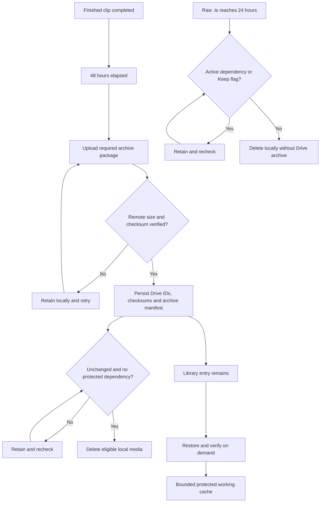
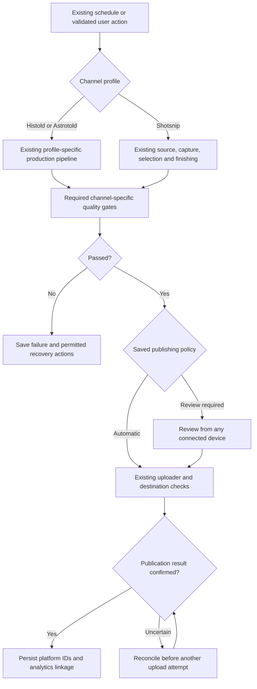

# Studio HQ — Final Merged Implementation Plan

Status: Studio HQ has platform analytics, a channel tool directory, and the first Phase 3 Planning views over Tailscale. Hourly Drive archiving and guarded retention continue in the background. See [planning and channel tools](phase-3.md), [analytics, controls and recovery](phase-2.md), and [storage operating notes](phase-0.md).

Updated: 21 November 2026.

## Goal

Create one private control room for Histold and Shotsnip across the two existing repositories. Access it from Windows, Android and Mac through the existing Tailscale network. Use existing computers for execution without adding paid cloud workers. Astrotold continues on its existing automation and storage policies outside Studio HQ.

Reuse Python pipelines and their existing quality, publishing and recovery rules. Build a Rust control service and one responsive React interface. Use existing Google Drive storage as the media archive. Native app shells and a new Mac worker agent are optional later additions.

## Agreed decisions

| Area | Final decision |
| --- | --- |
| Host | Existing Windows PC; services continue independently of the app window |
| Clients | Responsive web app on Windows, Android and Mac; installable where supported |
| Private access | Existing Tailscale with HTTPS through Serve and application authorization |
| Backend | Rust with Axum/Tokio; SQLite through sqlx; adapters around existing engines |
| Frontend | React + TypeScript + Vite; one shared interface |
| Processing | Existing Python, FFmpeg, local models and uploaders |
| Drive transfers | rclone supervised by an archive service; app owns eligibility and verification records |
| State | Existing publishing/job ledgers remain authoritative; hub stores references and its own records |
| Scheduling | Preserve existing ownership initially; migrate one workflow at a time only after parity |
| Finished clips | Archive eligibility after 48 hours from finished-clip completion |
| Raw `.ts` segments | Local deletion eligibility after 24 hours; exclude from automatic Drive archive |
| Cleanup protections | Keep flags, active jobs, pending publication and unresolved publishing protect required files |
| Paid cloud workers | No new paid workers; inventory existing hosted workflows before changing execution location |
| Native apps | Optional Tauri shells after the shared web app proves useful |
| Mac worker | Observe existing Mac runners first; add a new distributed agent only for a demonstrated need |

No new worker hosting bill does not mean zero running cost. Existing electricity, internet, storage subscription and configured AI/API usage still apply.

## Architecture



The first version does not require a new Mac execution service. A Mac can control the system without running processing. Existing Mac workflows are inventoried and monitored; changing their ownership is a separate migration.

## Product areas

| Area | Purpose |
| --- | --- |
| Mission control | Cross-channel jobs, next actions, failures and freshness |
| Pipeline | Stage events, logs, artifacts and permitted recovery actions |
| Approvals | Existing review requirements and consequential proposals |
| Studio and library | Manual creation, previews, captions, sources, archived media and restores |
| Storage | Local free space, Drive quota, protected files, transfer queue and cleanup history |
| Health | Backend, workers, existing runners, model services and account connection status |
| Analytics and money | Actual platform observations, API costs and attributable earnings where available |
| Strategy lab | Topic backlog, hypotheses, experiments, packaging and recommendations with evidence |
| Calendar | Cross-channel planned posts and actual publication; editable only after schedule ownership is defined |
| Assistant | Read scoped data and propose validated actions using existing capabilities |

Mobile prioritizes reviewing, monitoring, previewing and pausing. Detailed editing and configuration favor larger screens. Offline clients show last-known data clearly and cannot submit execution commands until reconnected.

## Phase 0 — Audit, storage protection and instrumentation

### Work

- Map actual commands, schedules, credentials, quality gates, job stores, worker locks and publication reconciliation across both repositories.
- Include Histold and Astrotold as separate channel profiles; preserve their different production rules.
- Inventory media, measure disk usage and check available Drive quota. Previous measurements are snapshots, not permanent assumptions.
- Define stable channel, job, artifact, event, command and publication identities.
- Instrument paid API calls with job/stage/provider, observed usage, pricing basis and retry costs. Label estimates and unknown values explicitly.
- Use per-worker event streams or one ingestion service. Do not have unrelated processes append unsafely to one shared event file.
- Build a small independent archive worker around rclone so disk protection does not wait for the full Rust app.
- Select archive candidates from completion records and dependencies rather than relying only on modification times or `--min-age`.
- Run archive eligibility checks hourly; transfers can be bandwidth-limited and resumed.
- Coordinate existing deletion paths before files selected for archiving can be removed.
- Collect retained Histold/Astrotold Actions artifacts before expiry while those workflows remain in use. Record their original completion time and source run ID.
- Test copy, verification and restoration with cleanup disabled; enable eligible local removal only after the checks pass.

### Exit conditions

Both repos expose stable job/event references. Required media can be archived and restored. Protected files survive cleanup. Every workflow has an explicit scheduler owner. Storage thresholds are based on measured working-space needs rather than a fixed free-space target.

## Phase 1 — Read-only Rust hub and cross-device app

### Work

- Implement the Rust service, SQLite schema/migrations and channel adapters.
- Import existing records without replacing authoritative publishing ledgers.
- Add authenticated job, artifact, archive, analytics and health endpoints.
- Serve the responsive React application through the existing Tailscale setup.
- Add mission control, pipeline inspection, health, library and storage views.
- Use backend events for progress; persist recoverable state so reconnecting clients can catch up.
- Keep the current dashboards available and compare their results with the new app.
- Display unavailable metrics, report timestamps, connection errors and stale data explicitly.

### Exit conditions

Windows, Android and Mac show the same underlying records and can preview permitted media. The new interface matches existing state without changing production execution. No credentials appear in browser responses or logs.

## Phase 2 — Validated controls and background reliability

### Work

- Enable existing create, pause/resume, cancel, strategist and safe retry actions progressively.
- Integrate existing approvals through adapters; do not create competing approval stores.
- Deduplicate commands across devices and revalidate channel, job and destination before execution.
- Allow stage retry only when dependencies and snapshots remain valid; edits invalidate affected downstream stages.
- Keep uncertain publication in reconciliation rather than offering blind retry.
- Run backend and worker supervision independently of the UI, with startup/restart recovery.
- Add consistent database snapshots and restore procedures, plus disk-pressure alerts.
- Offer archive-now, restore and authenticated archived-media access with a bounded local cache.
- Migrate scheduled tasks or external triggers one at a time if useful. Disable the previous owner before the new owner becomes active; preserve caps and slot claims.
- Add notifications using existing channels first. Consider self-hosted ntfy only after Android background delivery has been tested.

### Approval policy

Routine scheduled work follows the owner's saved automation policy. Require review for consequential exceptions such as account changes, code-change proposals and ambiguous publication recovery. Do not add a manual confirmation to every routine job.

### Exit conditions

Repeated commands, connection loss, concurrent clients, worker failure and host restart cannot duplicate publication. The UI can close without stopping independently managed workers. The archive and job ledgers survive recovery. Scheduler migration has a tested rollback.

**First operational release: Phases 0–2 complete.**

## Phase 3 — Strategy, calendar, cost and earnings

### Work

- Track ideas, reservations, exclusions and content provenance through production and publication.
- Add experiment definitions, variants, matched-age observations, sample sizes and evidence limitations.
- Compare hooks, duration, categories, sources and packaging only where compatible evidence exists.
- Show recorded costs, including failed attempts; do not invent historical API charges.
- Keep platform earnings, reporting periods, currencies and attribution boundaries explicit. Missing earnings remain unavailable.
- Add a cross-channel calendar; changes go through the workflow's single scheduler owner.
- Connect the existing assistant to scoped evidence and validated action proposals.
- Preserve research and quality gates. A disputed material claim cannot become a non-blocking advisory merely because a dashboard offers an approval button.

### Exit conditions

An idea can be traced to its job, publication, actual observations and costs. Recommendations explain their evidence and uncertainty. Calendar edits cannot bypass publication rules.

## Phase 4 — Optional native apps and distributed workers

- Package the shared frontend in Tauri if tray access, notifications or native integration justify it.
- Keep browser/installable web access as a supported option on Android and Mac.
- Add a new Mac agent only if existing runner integration is insufficient and a workload benefits from it.
- Before distributed execution, define job leases, heartbeats, disconnect recovery, credential ownership and protection against duplicate work/publication.
- Treat native Android notifications and widgets as explicit features, not automatic results of packaging.
- Retire old dashboards only after feature parity, recovery and rollback validation; do not delete modules still used by adapters.

**Exit condition:** optional additions solve demonstrated friction without creating a separate product or competing execution owner.

## Storage policy

| Content | Final policy |
| --- | --- |
| Finished video | Eligible for Drive archive at 48 hours from completion; delete eligible local copy only after verified archive and dependency checks |
| Captions, thumbnails, script, research and metadata | Required archive package where applicable; retain lightweight local library records |
| Raw `.ts` segments | Eligible for local deletion at 24 hours if unneeded and unprotected; no automatic Drive archive |
| Other raw MP4s and render scratch | Inventory separately; define explicit eligibility and dependency rules before deletion |
| Explicit Keep files | Exempt from automatic cleanup until released |
| Active jobs, pending publication and unresolved publication | Protect all dependent files regardless of age |
| Databases and publishing ledgers | Keep locally; archive consistent snapshots, not live database files |
| Credentials and tokens | Protected host storage; exclude from media archives and ordinary database export bundles |

An age threshold means eligibility, not exact deletion time. Transfer duration and dependency protection can extend local retention. Preserve original completion timestamps across imports, copies and restores.



### Archive safeguards

- Verify every required file, not just one MP4 or a successful transfer exit status.
- Record remote file IDs and content verification results before local deletion.
- If checksum metadata is unavailable, retain the file until an alternative content verification succeeds.
- Recheck local identity/content and dependencies under coordinated locks before removal.
- Avoid mirrored-folder deletion semantics; removing a local working copy must not delete its Drive archive.
- Use unique job/artifact identities to avoid duplicate archives after restarts.
- Leave failed/unverified archives local. If storage becomes critically low, pause new capture rather than deleting protected or unverified finished media.
- A restored copy retains the original completion age and is protected while in use; restoration never starts publication by itself.
- Bound download/streaming caches so Drive-only playback does not silently refill the disk.
- Keep archives private and access them through authenticated app routes or the user's Drive account.

Proposed folder structure:

```text
StudioHQ/
  Histold/YYYY/MM/<job-id>/
  Astrotold/YYYY/MM/<job-id>/
  Shotsnip/YYYY/MM/<job-id>/
  Backups/
```

## Publishing workflow



Publication status and archive status remain separate. Publication success does not prove archive success. Pending publication or reconciliation can protect required files even after a Drive archive verifies.

## Existing locations and migration notes

| Content | Observed location or behavior |
| --- | --- |
| Shotsnip scheduled runs | `D:\YT-Cliping-Automation\work\scheduler` |
| Shotsnip manual runs | `D:\YT-Cliping-Automation\work\manual` |
| Shotsnip live files | `D:\YT-Cliping-Automation\work\live` |
| Clips Kitty downloaded sources | `D:\Clips-Kitty\data\downloads` |
| Histold local output | `D:\YT-Automation\output` |
| Channel-specific output | Reconfirm each channel configuration, including Astrotold |
| Existing GitHub artifacts | Relevant publish workflows configured for 14-day retention at inspection |

Existing Histold post-upload deletion/pruning and Shotsnip raw cleanup must be coordinated with archive eligibility. Do not assume every final video already exists on the Windows PC. Download retained remote artifacts before expiry while existing workflows remain in use. Recovering already expired artifacts is not guaranteed.

Preferred hub-owned directory: `D:\StudioHQ` for application data, transfer configuration and logs. Keep existing repo paths intact initially. Configure tool/cache locations explicitly where supported; do not promise that every operating-system-managed file resides on D:.

## Security and availability

- Bind the service to loopback behind the trusted Tailscale Serve proxy.
- Enforce permitted identities and action authorization. Trust identity headers only through the configured proxy boundary; protect state-changing browser requests as well.
- Keep media paths confined to approved roots and redact secrets/signed URLs from logs and events.
- Preserve application authentication as appropriate. A shared access key is an extra credential, not automatically a second authentication factor.
- The Windows host is a single point of failure. Its shutdown makes the custom app unavailable and stops work hosted there.
- Telegram can provide an alternate interface when a phone is off Tailscale, but a Windows-hosted bot does not restore a failed Windows hub.
- Existing independent workflows provide only the fallback capability actually configured; audit this rather than assuming failover.
- Archived Drive files can be accessed in Drive independently of the host; the custom dashboard still requires the host.

## Validation and rollout

For each phase: inspect, implement one complete path, verify it, then enable it gradually. Keep read-only coexistence and explicit rollback before replacing a dashboard, scheduler or worker owner.

Required scenarios:

- Same job records and authorized previews on Windows, Android and Mac.
- Reconnect after stale/offline state without losing durable progress.
- Repeated commands and overlapping clients cannot duplicate jobs or publication.
- Interrupted processing and uncertain publication follow different recovery paths.
- Archive interruption, quota exhaustion or checksum mismatch retain local finished media.
- Successful archive can be restored and verified before cleanup is enabled.
- Cleanup protects active dependencies and Keep files and stays within allowed roots.
- The 48-hour finished-clip rule and 24-hour raw `.ts` rule remain distinct.
- Restores and artifact imports preserve original completion times.
- Database snapshots restore correctly and omit credentials.
- Closing the UI does not stop independent workers; restart preserves authoritative records.
- Scheduler cutover preserves caps, slot ownership and a tested rollback.

First prove one complete Shotsnip path: a clip appears on Android/Mac, archives after eligibility, releases local space safely and restores correctly. Apply the same contract to Histold and Astrotold without changing their production profiles.

Success means less manual intervention, easier recovery, predictable storage use and decisions backed by actual observations. Phase timing is estimated only after the audit; free-space targets and notification behavior must be measured rather than assumed.

## References

- [Tauri architecture](https://v2.tauri.app/concept/architecture/)
- [Installable web apps](https://developer.mozilla.org/en-US/docs/Web/Progressive_web_apps/Guides/Making_PWAs_installable)
- [Tailscale Serve](https://tailscale.com/docs/features/tailscale-serve)
- [rclone filtering](https://rclone.org/filtering/)
- [rclone verification](https://rclone.org/commands/rclone_check/)
- [Google Drive uploads](https://developers.google.com/workspace/drive/api/guides/manage-uploads)
- [Google Drive file metadata and checksums](https://developers.google.com/workspace/drive/api/reference/rest/v3/files)

Merged from the agreed plan in this chat and the reviewed Studio HQ Blueprint. Suggestions in that blueprint are design inputs; they do not themselves authorize installations, schedule changes, credential changes, uploads or deletions.
